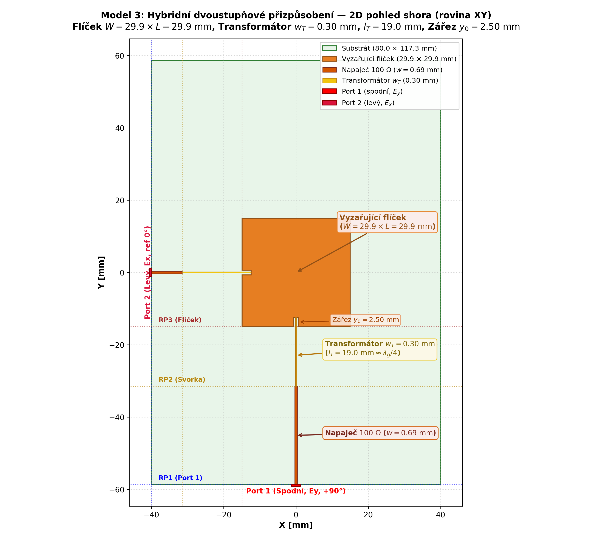
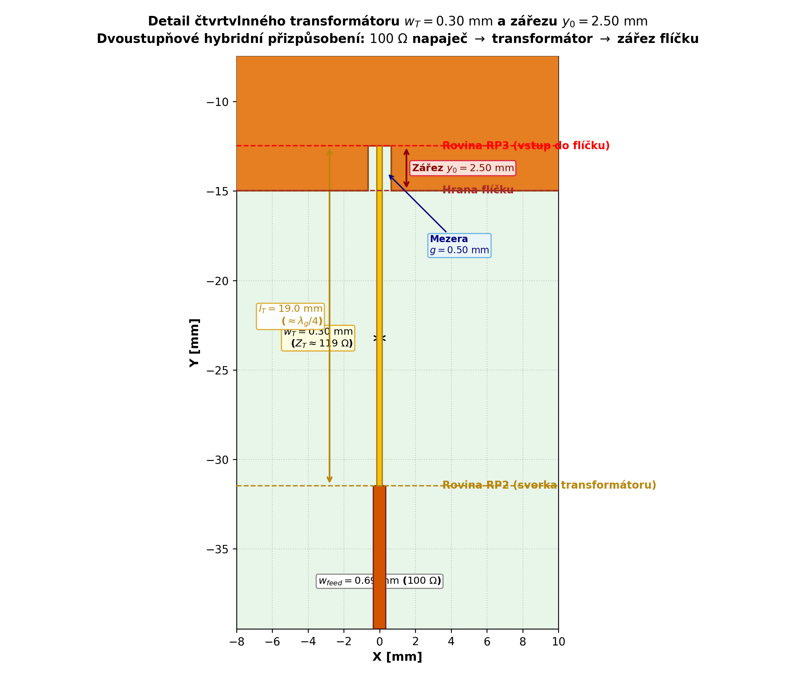
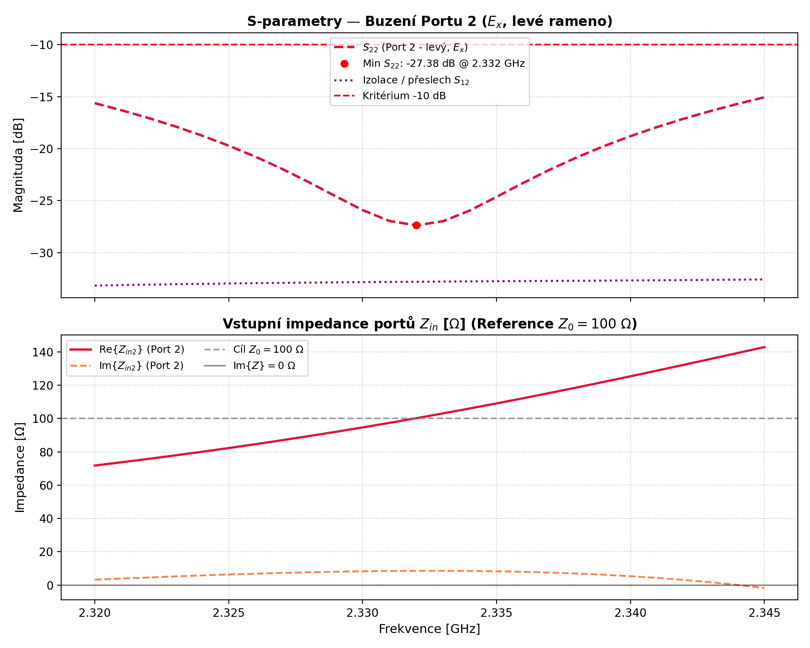
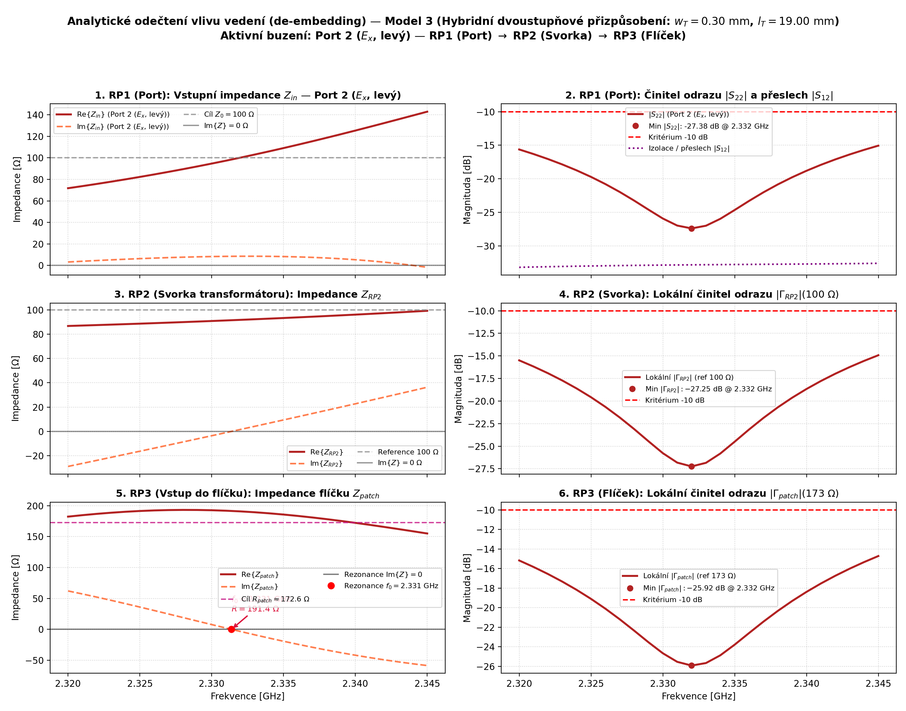
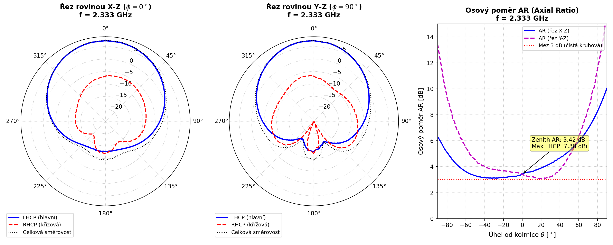
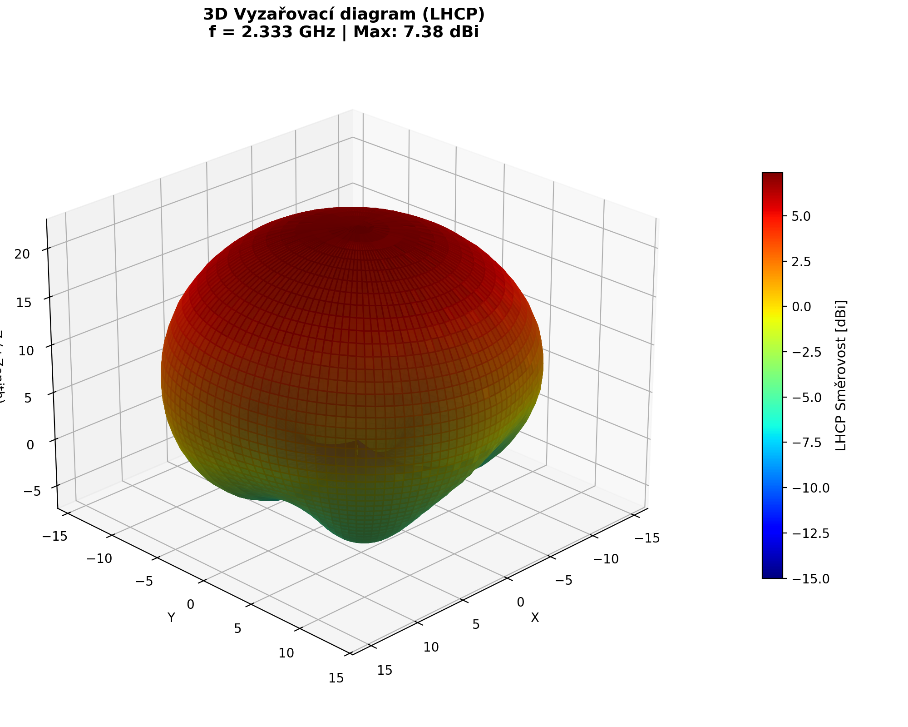

# SDARS LHCP Microstrip Patch Antenna — Simulation & Optimization Pipeline

A containerized 3D electromagnetic simulation, CAD generation, and RF post-processing pipeline for designing a **Left-Hand Circularly Polarized (LHCP)** microstrip patch antenna targeting the **SDARS band (2.320–2.345 GHz)** on an FR-4 substrate.

The workflow automates parametric OpenCASCADE geometry construction, conformal Gmsh meshing, full-wave finite-element (FEM) simulation with Adaptive Mesh Refinement (AMR) in **AWS Palace**, analytical transmission-line de-embedding, far-field polarization evaluation, and 3D **ParaView** visualization.

---

## RF Design Specifications

| Parameter | Target / Value | Notes |
| :--- | :--- | :--- |
| **Frequency Band** | `2.320 – 2.345 GHz` | SDARS band (`B = 25 MHz`), center frequency `f_c = 2.3325 GHz` |
| **Polarization** | LHCP | Left-Hand Circular Polarization (`E_LHCP` via quadrature feed) |
| **Reflection Coefficient (`S11`)** | `< -10 dB` across band | Stretch target `< -15 dB` (`50 Ω` for Model 1; `100 Ω` per port for Models 2 & 3) |
| **Antenna Gain (`G_LHCP`)** | `>= 5.5 dBi` (+Z boresight) | Stretch target `> 6.0 dBi` |
| **Axial Ratio (`AR`)** | `< 3.0 dB` across band | Stretch target `< 1.5 dB` at `f_c` |
| **Substrate (FR-4)** | `h = 1.52 mm`, `ε_r = 4.3`, `tan δ = 0.02` | `36 μm` copper modeled as zero-thickness PEC boundary surfaces |

### Technology Stack

- **Parametric CAD & Meshing:** OpenCASCADE (`gmsh` OCC kernel) with Boolean Fragments for conformal interface meshing and localized conductor/slot refinement.
- **Full-Wave EM Solver:** [AWS Labs Palace](https://github.com/awslabs/palace) FEM solver with Adaptive Mesh Refinement (AMR), SuperLU / FGMRES linear solver, second-order absorbing air-box boundaries (`>= λ_0 / 4` clearance), and far-field sphere integration.
- **Orchestration & Post-Processing:** Python (`numpy`, `pandas`, `scipy`, `matplotlib`, `pyvista`, `meshio`, `python-dotenv`) inside Docker Compose.
- **3D Field Visualization:** ParaView (`.pvd` / `.pvtu` time/frequency series and interactive phasor rotation macros).

---

## Antenna Architectures

Three progressively refined antenna topologies are implemented and selectable via `ANTENNA_MODEL` in `.env` or `--model` on the CLI:

### 1. Model 1 (obsolete) — 50 Ω T-Junction Power Divider ([`src/geometry_v1.py`](src/geometry_v1.py))
- **Topology:** Single `50 Ω` input feed (`w1 ≈ 2.98 mm`) connected to a symmetric T-junction power divider splitting into two orthogonal `100 Ω` branches (`w2 ≈ 0.69 mm`, natural match `Z_in,T = 100 Ω || 100 Ω = 50 Ω`).
- **Quadrature Phasing:** The bottom branch (`E_y`) serves as the `0°` reference, while the left branch (`E_x`) adds a `λ_g / 4` (`≈ 18.66 mm` at `f_c = 2.3325 GHz`, `ε_eff ≈ 2.97`) delay section for `-90°` phase shift.
- **Tuning Parameters:** Patch dimensions (`PATCH_L`, `PATCH_W`, default `30.30 mm`), connection trace width `w3` (`w3 <= w2`), and optional inset feed (`FEED_INSET`).

### 2. Model 2 (obsolete) — Dual-Port 100 Ω Direct Inset Feed ([`src/geometry_v2.py`](src/geometry_v2.py))
- **Topology:** Decouples the two orthogonal excitations into two independent `100 Ω` lumped ports (`w_feed ≈ 0.694 mm`) feeding the bottom (`Port 1`, `E_y`) and left (`Port 2`, `E_x`) edges directly, eliminating parasitic routing coupling from the T-junction.
- **Quadrature Phasing & Excitation Modes:** Port 1 incorporates a `ΔL = λ_g / 4` (`≈ 18.66 mm`) line extension. Supports isolated single-port tuning (`DRIVEN_PORT=1` or `2`), simultaneous dual-port driving, or full two-step S-matrix superposition (`DRIVEN_PORT=all`).
- **Tuning Parameters:** Independent asymmetric inset depths (`FEED_INSET_B`, `FEED_INSET_L`, typically `4.8–5.4 mm` for `L = W = 28.80 mm`), slot gaps, and explicit feed lengths (`FEED_LEN_B`, `FEED_LEN_L`, `FEED_DELTA_L`). Because deep insets lower resonance and interact with the `λ_g / 4` delay line via impedance inversion, this architecture motivated Model 3.

### 3. Model 3 — Hybrid Two-Stage Matching ([`src/geometry_v3.py`](src/geometry_v3.py))
- **Topology (Path B):** Combines a **shallow inset notch** (`y0b = y0l ≈ 2.50 mm`, gap `g = 0.50 mm`) with an internal **quarter-wave impedance transformer** (`w_T`, `l_T ≈ λ_g / 4 ≈ 18.9–19.0 mm`) feeding an outer **`100 Ω` microstrip line** (`w_feed ≈ 0.694 mm`) with the `ΔL ≈ 18.66 mm` quadrature delay on Port 1.
- **Physical Advantage:**
  - The shallow notch reduces patch edge resistance (`R_edge ≈ 180–220 Ω`) to `~140 Ω` without distorting the orthogonal `TM_10` / `TM_01` modal currents, yielding a manufacturable transformer width (`w_T ≈ 0.42 mm` nominal for `Z_T ≈ 118.7 Ω`, tunable down to `0.30 mm`).
  - Matching occurs *before* the outer `100 Ω` feed line, so the `λ_g / 4` phase-delay section on Port 1 operates in a matched `100 Ω` environment without acting as an impedance inverter, restoring symmetry between Port 1 and Port 2.

---

## Sample Simulation Results

> **Note:** The geometry, S-parameter, and de-embedding plots below show a selected **Model 3** simulation run (`L = W = 29.95 mm`, `w_T = 0.30 mm`, `y0 = 2.50 mm`, single-port excitation on Port 2). The 2D and 3D far-field radiation pattern plots show a selected dual-port LHCP simulation run evaluated at `f = 2.333 GHz`.

| Model 3 Top-Down Layout (RP1 / RP2 / RP3) | Quarter-Wave Transformer & Shallow Notch Detail |
| :---: | :---: |
|  |  |

| S-Parameters & Input Impedance (Model 3, Port 2) | Analytical De-Embedding RP1 → RP2 → RP3 (Model 3) |
| :---: | :---: |
|  |  |

| 2D Polar Cuts & Axial Ratio (`f = 2.333 GHz`) | 3D LHCP Directivity Pattern (`f = 2.333 GHz`) |
| :---: | :---: |
|  |  |

---

## Quick Start

### Prerequisites
- **Docker** & **Docker Compose** (with WSL2 or Hyper-V enabled on Windows) for containerized meshing and AWS Palace FEM execution.
- **Python 3.11+** for local CAD/mesh dry-runs, post-processing scripts, and running `pytest`.
- **ParaView** (optional, local desktop) for interactive 3D field inspection and phase rotation animations.

### 1. Configure Environment Variables
Copy the template configuration file to `.env` and adjust model, substrate, frequency sweep, or mesh/AMR settings as needed:

```bash
cp .env.example .env
```

*(On Windows PowerShell / CMD: `copy .env.example .env`)*

### 2. Build Docker Images
Build both the Python/Gmsh orchestration image (`pipeline`) and the AWS Palace FEM solver image (`palace`):

```bash
docker compose --profile worker build
```

### 3. Run a Single Simulation
Run the full CAD → Gmsh → Palace → post-processing pipeline inside Docker using the configuration from `.env`:

```bash
docker compose run --rm pipeline python src/main.py
```

Common CLI overrides are available on [`src/main.py`](src/main.py) (e.g., `--model 3`, `--patch-l 29.95`, `--trans-w 0.30`, `--inset-b 2.5 --inset-l 2.5`, `--driven-port all`, `--freq-min 2.320 --freq-max 2.345 --freq-step 0.001`, `--amr-its 2`, `--clean`).

To generate the CAD `.step` geometry, conformal `.msh` mesh, `config.json`, and layout previews **locally without invoking the Palace Docker solver**:

```bash
python src/main.py --skip-simulation
```

### 4. Run a Parametric Sweep
Execute a parametric sweep via the unified dispatcher [`src/sweep.py`](src/sweep.py):

```bash
docker compose run --rm pipeline python src/sweep.py
```

The dispatcher routes to the active model (`ANTENNA_MODEL` or `--model {1,2,3}`) and supports `.env` profiles (`SWEEP_PROFILE=precise` with AMR enabled or `SWEEP_PROFILE=fast` for rapid exploration), sweep targets (`--sweep-target` supporting `patch_l`, `trans_w`, `trans_l`, `delta_l`, `inset`, `feed_lens`), sweep modes (`--mode {symmetric,single_fixed,grid,manual}`), and local dry-runs (`--skip-simulation`).

### 5. Run Tests
Install local development dependencies from [`requirements-dev.txt`](requirements-dev.txt) and verify analytical RF calculations, de-embedding math, CAD/mesh generation, Palace config generation, plotting rules, and code linting:

```bash
pip install -r requirements-dev.txt
python -m pytest -v
ruff check .
```

---

## Post-Processing & Analysis

### Summary Tables (`export/`)
Each simulation and sweep step automatically extracts RF metrics in [`src/tracker.py`](src/tracker.py) and appends structured logs into `export/`:
- **Model 1:** (obsolete) `export/sweep_results.csv` and `export/sweep_results.md`
- **Model 2:** (obsolete) `export/sweep_results_model2.csv` and `export/sweep_results_model2.md`
- **Model 3:** `export/sweep_results_model3.csv` and `export/sweep_results_model3.md`

Tracked metrics include resonant frequencies (`f0`, `f0_b`, `f0_l`), reflection minima (`S11_min`, `S22_min`), `-10 dB` impedance bandwidth, port input impedance (`Zin`), LHCP/RHCP gain (`Gain_LHCP`, `Gain_max_LHCP` and `fGainMaxLhcp`), Axial Ratio (`AR`), and polarization sense. When `SWEEP_EXPORT_EACH=true`, each step can also archive plots, CAD geometry, and solver configs into a self-contained ZIP package.

### Analytical De-Embedding (RP1 / RP2 / RP3)
To separate feed-network behavior from intrinsic patch resonance, [`src/rf_calc.py`](src/rf_calc.py) (`calculate_deembedding_model3`) and [`scripts/plot_deembedding.py`](scripts/plot_deembedding.py) analytically de-embed complex impedance across three reference planes:

```text
[RP1: 100 Ω Port] --- (100 Ω line L_100) ---> [RP2: Transformer Terminal] --- (λg/4 Transformer w_T, l_T) ---> [RP3: Patch Notch Input]
```

1. **RP1 (Input Port):** Displays port impedance `Z_in` (`Re` and `Im` with `100 Ω` reference) and reflection `|S11|` / `|S22|` in dB alongside cross-port coupling/isolation (`|S21|` / `|S12|`).
2. **RP2 (Transformer Terminal):** Subtracts the outer `100 Ω` microstrip section (`L_100`), plotting `Z_RP2` (target `100 + j0 Ω`) and local reflection `|Γ_RP2|` to verify transformer performance.
3. **RP3 (Patch Input at Notch):** Subtracts the quarter-wave transformer (`w_T`, `l_T`; for Model 2, `l_T = 0` so RP2 coincides with RP3) to extract the intrinsic patch impedance `Z_patch` (nominal `~140 Ω` for `y0 = 2.5 mm`), automatically detects intrinsic resonance `f0` at `Im{Z_patch} = 0`, and plots local reflection `|Γ_patch|`.

For single-port excitation (`DRIVEN_PORT=1` or `2`), only the active port chain is plotted (plus cross-port isolation on RP1). For dual-port excitation (`DRIVEN_PORT=all`), both polarizations are rendered side-by-side (`--layout split`) or combined (`--layout compact`).

### Post-Processing Scripts (`scripts/`)
All standalone plotting and packaging tools accept an optional exported run directory (e.g., `export/<run_dir>`). When invoked **without a path argument**, they default to reading simulation outputs from `DATA_DIR/postpro` (falling back to `DATA_DIR`) as configured in `.env` (likewise, [`src/visualization.py`](src/visualization.py) defaults to reading `DATA_DIR/params.json` and writing `DATA_DIR/geometry_iso.png`):

- [`scripts/plot_s_parameters.py`](scripts/plot_s_parameters.py) — Plots `S11`, `S22`, cross-port isolation `S21`/`S12`, and port input impedance (`graf_S_parametry.png` and individual sub-plots in `grafy/`):
  ```bash
  python scripts/plot_s_parameters.py export/<run_dir>
  ```
- [`scripts/plot_radiation_pattern.py`](scripts/plot_radiation_pattern.py) — Evaluates spherical `E_theta`/`E_phi`, LHCP/RHCP directivity in dBi, and Axial Ratio from `farfield-rE.csv`, generating `vyzarovaci_diagram_2d.png` (X-Z and Y-Z polar cuts + AR vs. θ) and `vyzarovaci_diagram_3d.png`:
  ```bash
  python scripts/plot_radiation_pattern.py export/<run_dir> --freq 2.333
  ```
- [`scripts/plot_deembedding.py`](scripts/plot_deembedding.py) — Computes and plots the RP1/RP2/RP3 impedance de-embedding diagnostics (`graf_impedance_skoky.png`):
  ```bash
  python scripts/plot_deembedding.py export/<run_dir> --layout split
  ```
- [`scripts/export_package.py`](scripts/export_package.py) — Bundles `.pvtu`/`.pvd` field datasets, `antenna_model.step`, CSV outputs, generated plots, and `paraview_dynamic_phase.py` into a portable ZIP archive under `export/`:
  ```bash
  python scripts/export_package.py --name antenna_run.zip
  ```
- [`scripts/export_lhcp_gif.py`](scripts/export_lhcp_gif.py) — Renders an animated GIF (`lhcp_rotation.gif`) showing instantaneous rotating electric field `E(ωt) = E_re cos(ωt) - E_im sin(ωt)` across a full `360°` cycle:
  ```bash
  python scripts/export_lhcp_gif.py
  ```

### ParaView 3D Visualization
When `SAVE_STEP=1` is enabled, Palace writes `.pvd` / `.pvtu` surface and volume field files to `data/postpro/paraview/`. Two macros are provided under `scripts/` (run inside ParaView via **Tools → Python Shell → Run Script**):
- [`scripts/paraview_macro.py`](scripts/paraview_macro.py) — Resets the ParaView scene, loads `driven_boundary.pvd` (or `driven.pvd`), adds a domain bounding box, creates a horizontal slice in the patch plane (`z = sub_h`) colored by `|E_real|`, and prepares a vertical X-Z radiation slice.
- [`scripts/paraview_dynamic_phase.py`](scripts/paraview_dynamic_phase.py) — Sets up real-time GPU-evaluated phasor animation (`0°–360°` rotation via ParaView's Play button) with vector glyphs (`E_phase`) and an interactive on-screen frequency slider (`2.320–2.345 GHz`).

---

## Repository Structure

```text
.
├── assets/                     # Representative figures for documentation
│   ├── deembedding_sample.png
│   ├── geometry_top_view.png
│   ├── radiation_pattern_2d.png
│   ├── radiation_pattern_3d.png
│   ├── s_parameters_sample.png
│   └── transformer_detail.png
├── docker/
│   ├── Dockerfile.palace       # Multi-stage build of AWS Palace FEM solver
│   └── Dockerfile.pipeline     # Python + Gmsh + PyVista orchestration image
├── scripts/
│   ├── _env.py                 # Path helper for standalone script execution
│   ├── export_lhcp_gif.py      # Rotating LHCP E-field GIF generator
│   ├── export_package.py       # Self-contained ZIP archive exporter
│   ├── generate_phase_animation.py  # PVD phase-series generator for ParaView
│   ├── paraview_dynamic_phase.py    # Interactive ParaView frequency/phase macro
│   ├── paraview_macro.py       # ParaView scene setup macro (slices & field LUT)
│   ├── plot_deembedding.py     # RP1/RP2/RP3 de-embedding diagnostic plotter
│   ├── plot_efield.py          # Headless PyVista E-field snapshot plotter
│   ├── plot_radiation_pattern.py    # 2D/3D LHCP/RHCP & Axial Ratio plotter
│   └── plot_s_parameters.py    # S-parameters, isolation & Zin plotter
├── src/
│   ├── geometry.py             # Antenna model router (Models 1, 2, 3)
│   ├── geometry_v1.py          # Model 1: 50 Ω T-junction divider patch
│   ├── geometry_v2.py          # Model 2: Dual-port 100 Ω direct inset patch
│   ├── geometry_v3.py          # Model 3: Hybrid shallow notch + λg/4 transformer
│   ├── main.py                 # Single-run pipeline CLI & orchestration
│   ├── mesh.py                 # Gmsh physical groups & adaptive mesh sizing
│   ├── palace_builder.py       # AWS Palace config.json generator
│   ├── postpro_utils.py        # .env loading, file syncing & 2-port superposition
│   ├── rf_calc.py              # Microstrip synthesis, dispersion & de-embedding
│   ├── runner.py               # Docker Compose Palace solver invocation
│   ├── sweep.py                # Unified parametric sweep CLI dispatcher
│   ├── sweep_model1.py         # Parametric sweep logic for Model 1
│   ├── sweep_model2.py         # Parametric sweep logic for Model 2
│   ├── sweep_model3.py         # Parametric sweep logic for Model 3
│   ├── tracker.py              # RF metric extraction & CSV/Markdown logging
│   └── visualization.py        # 2D geometry & transformer detail rendering
├── tests/
│   ├── test_deembedding.py     # Propagation, de-embedding & plotting tests
│   ├── test_model2.py          # Model 2 RF, CAD, tracker & sweep tests
│   └── test_model3.py          # Model 3 RF, CAD, mesh, Palace & sweep tests
├── .env.example                # Documented template configuration
├── .gitignore
├── docker-compose.yml          # Docker services (pipeline & palace worker)
├── LICENSE
├── pyproject.toml              # Pytest & Ruff configuration
├── README.md
├── requirements-dev.txt        # Local test & lint dependencies (pytest, ruff)
└── requirements.txt
```

---

## License

This project is licensed under the MIT License — see the [LICENSE](LICENSE) file for details.
