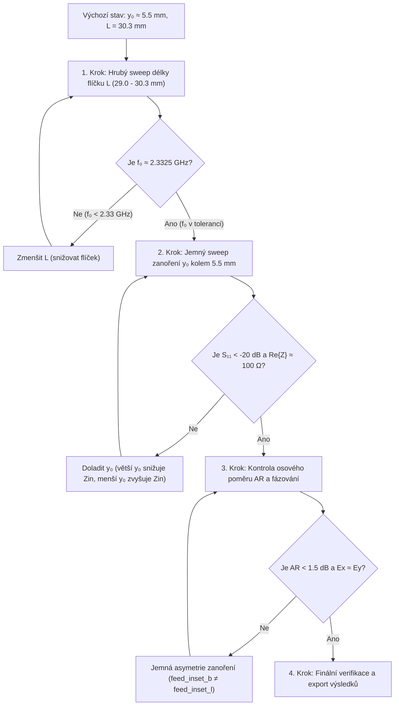

# 📓 Zápisník návrhu a ladění LHCP patch antény

Tento zápisník slouží jako centrální inženýrský deník pro dokumentaci poznatků, záznam jednotlivých simulačních iterací a popis systematického postupu návrhu mikropáskové kruhově polarizované (LHCP) patch antény pro frekvenční pásmo **2.320 – 2.345 GHz** ($f_c = 2.3325\text{ GHz}$).

---

## 1. Výchozí technické zadání a limity

| Parametr | Cílová hodnota | Tolerance / Kritický limit | Význam pro návrh |
| :--- | :--- | :--- | :--- |
| **Pracovní pásmo** | 2.320 – 2.345 GHz | SDARS pásmo ($B = 25\text{ MHz}$) | Střední návrhová frekvence $f_c = 2.3325\text{ GHz}$ |
| **Polarizace** | LHCP | Levotočivá kruhová | Generována kvadraturním buzením dvou ortogonálních módů |
| **Osový poměr ($AR$)** | $< 1.5\text{ dB}$ | $< 3.0\text{ dB}$ v pásmu | Měřítko čistoty kruhové polarizace |
| **Činitel odrazu ($S_{11}$)** | $< -15\text{ dB}$ | $< -10\text{ dB}$ v pásmu | Impedanční přizpůsobení na $50\,\Omega$ ($100\,\Omega$ na port u M2) |
| **Zisk antény ($G_{\text{LHCP}}$)** | $> 6.0\text{ dBi}$ | $\ge 5.5\text{ dBi}$ v ose $+Z$ | Vyzařovací účinnost a směrovost |
| **Substrát** | FR-4 | $h = 1.52\text{ mm}, \varepsilon_r = 4.3, \tan\delta = 0.02$ | Standardní nízkonákladový materiál DPS |

---

## 2. Fyzikální strategie: Vazba zanoření ($y_0$) a rozměru flíčku ($L$)

### 2.1 Proč zanoření ($y_0 \approx 5.5\text{ mm}$) snižuje rezonanční kmitočet?
Vstupní impedance na vnější vyzařující hraně mikropáskového flíčku je přirozeně vysoká ($R_{\text{edge}} \approx 160\text{ až }200\,\Omega$). Pro přímé přizpůsobení k $100\,\Omega$ mikropáskovým větvím bez složitých transformačních článků se využívá zářez napaječe (inset feed) o hloubce $y_0$:
$$R_{\text{in}}(y_0) \approx R_{\text{edge}} \cdot \cos^2\left(\frac{\pi y_0}{L}\right)$$
Pro $R_{\text{edge}} \approx 170\,\Omega$ a $Z_0 = 100\,\Omega$ vychází teoretická hodnota $y_0 \approx 5.2\text{ až }5.7\text{ mm}$.

**Fyzikální důsledek zářezu:**
1. **Zvýšení efektivní indukčnosti:** Výřezy podél napájecího pásku tvoří štěrbinové nespojitosti, které vnášejí sériovou parazitní indukčnost.
2. **Prodloužení proudových drah:** Povrchové proudy dominantního módu musí zářez obcházet, což prodlužuje jejich efektivní dráhu.
3. **Výsledek:** Se zvětšujícím se zanořením $y_0$ **klesá rezonanční frekvence $f_0$** (flíček se chová elektricky delší).

### 2.2 Proč musíme snižovat rozměr flíčku ($L$)?
Protože zanoření posouvá rezonanci směrem dolů pod požadované pásmo ($f_0 < 2.320\text{ GHz}$), je nutné fyzickou délku a šířku flíčku $L = W$ **postupně snižovat** (z původních $30.30\text{ mm}$ do oblasti cca $29.0\text{ až }29.7\text{ mm}$), aby se rezonance vrátila přesně na $f_c = 2.3325\text{ GHz}$.

### 2.3 Kritická závislost fázovacího zpoždění na $f_0$
Fázovací úsek $\Delta L = \lambda_g / 4 \approx 18.66\text{ mm}$ je pevnou fyzickou délkou navrženou pro jedinou frekvenci $f_c = 2.3325\text{ GHz}$:
$$\Delta \Phi = \beta \cdot \Delta L = \frac{2\pi f \sqrt{\varepsilon_{\text{eff}}}}{c_0} \cdot \frac{\lambda_g(f_c)}{4} = 90^\circ \cdot \frac{f}{f_c}$$
* Pokud se rezonanční frekvence flíčku $f_0$ neshoduje s $f_c$, flíček vyzařuje na jiné frekvenci, kde fázový posuv $\Delta \Phi \ne 90^\circ$.
* Jakýkoliv posun $f_0$ mimo zadání proto **přímo ničí osový poměr ($AR$)** a z kruhové polarizace se stává polarizace eliptická.

---

## 3. Sledované veličiny a jejich diagnostický význam

Při každé iteraci vyhodnocujeme následující parametry:

| Parametr | Jednotka | Co indikuje ve struktuře (Diagnostický význam) | Cíl |
| :--- | :--- | :--- | :--- |
| **$f_{0,b}, f_{0,l}$** | $\text{GHz}$ | Rezonanční frekvence spodního ($E_y$) a levého ($E_x$) módu. Indikuje elektrickou délku flíčku a kompenzaci zářezu. | **$2.3325\text{ GHz}$** (shoda s $f_c$) |
| **$S_{11,\min}, S_{22,\min}$** | $\text{dB}$ | Hloubka přizpůsobení na portech. Indikuje optimálnost hloubky zanoření $y_0$. | **$< -20\text{ dB}$** (min. $< -10\text{ dB}$) |
| **$Z_{\text{in1}}, Z_{\text{in2}}$** | $\Omega$ | Vstupní impedance v rezonanci. $\text{Re}\{Z\} \to 100\,\Omega$, $\text{Im}\{Z\} \to 0\,\Omega$. Zobrazuje reaktivní charakter zářezu. | **$100.0 + j0.0\,\Omega$** |
| **$AR$ (Axial Ratio)** | $\text{dB}$ | Osový poměr v ose vyzařování ($+Z$). Indikuje rovnováhu amplitud $|E_x|/|E_y|$ a fázový posun $\Delta \Phi = 90^\circ$. | **$< 1.5\text{ dB}$** (max. $< 3\text{ dB}$) |
| **$G_{\text{LHCP}}$** | $\text{dBi}$ | Zisk antény v žádané levotočivé polarizaci v ose $+Z$ na frekvenci rezonance. | **$\ge 5.5\text{ dBi}$** |
| **$G_{\max,\text{LHCP}}, f_{G\max}$** | $\text{dBi}, \text{GHz}$ | Maximální zisk LHCP a frekvence, kde k němu dochází. Upozorní, zda není maximum vyzařování posunuté vůči minimu $S_{11}$. | $f_{G\max} \approx f_c$, zisk $> 6.0\text{ dBi}$ |
| **$E_{\text{LHCP}} / E_{\text{RHCP}}$** | $\text{V / V}$ | Potlačení křížové polarizace. Indikuje čistotu rotace vektoru $\vec{E}$. | $E_{\text{LHCP}} \gg E_{\text{RHCP}}$ (rozdíl $> 15\text{ dB}$) |
| **$S_{21}$ / Izolace** | $\text{dB}$ | Přeslech mezi ortogonálními porty (vzájemná vazba flíčkem a substrátem). | $< -20\text{ dB}$ |

---

## 4. Systematický iterační postup ladění



### Krok 1: Nalezení nominální délky flíčku $L$ při $y_0 = 5.5\text{ mm}$
1. Nastavit v `.env`:
   - `ANTENNA_MODEL=2`
   - `FEED_INSET_B=5.5`
   - `FEED_INSET_L=5.5`
2. Zvolit testovací rozměry $L \in [29.2, 29.5, 29.8, 30.1]\text{ mm}$.
3. Cíl: Najít délku $L_{\text{opt}}$, při které $f_0$ leží přesně na $2.3325\text{ GHz}$.

### Krok 2: Jemné doladění hloubky zanoření $y_0$ kolem $5.5\text{ mm}$
1. Zafixovat $L = L_{\text{opt}}$.
2. Nastavit sweep zanoření v rozsahu $y_0 \in [5.1, 5.3, 5.5, 5.7, 5.9]\text{ mm}$ s krokem $0.2\text{ mm}$.
3. Cíl: Minimalizovat činitel odrazu ($S_{11} < -20\text{ dB}$) a dosáhnout $R_{\text{in}} \approx 100\,\Omega$.

### Krok 3: Vyvážení amplitud a optimalizace osového poměru ($AR$)
1. Zkontrolovat rozdíl amplitud $|E_x|$ a $|E_y|$ v dálkovém poli.
2. Pokud dochází k drobné asymetrii buzení (např. vlivem rozdílného uspořádání ramen), využít asymetrické zanoření:
   - Režim `SWEEP_MODE=single_fixed` nebo `SWEEP_MODE=grid` v `sweep_model2.py`.
   - Nezávislé jemné ladění `feed_inset_b` vs. `feed_inset_l` s krokem $0.1\text{ mm}$.
3. Cíl: Stlačit $AR$ pod $1.5\text{ dB}$ na střední frekvenci $f_c = 2.3325\text{ GHz}$.

---

## 5. Záznamový deník simulačních iterací

Do této tabulky se chronologicky zapisují jednotlivé série a kroky simulace:

| Iterace / Run | Model | $L$ [mm] | $W$ [mm] | $y_{0b}$ [mm] | $y_{0l}$ [mm] | $f_{0,b}$ [GHz] | $f_{0,l}$ [GHz] | $S_{11}$ [dB] | $S_{22}$ [dB] | $Z_{\text{in1}} [\Omega]$ | $Z_{\text{in2}} [\Omega]$ | $G_{\text{LHCP}}$ [dBi] | $AR$ [dB] | Diagnostické zhodnocení a další krok |
| :--- | :---: | :---: | :---: | :---: | :---: | :---: | :---: | :---: | :---: | :---: | :---: | :---: | :---: | :--- |
| *Ref-M1-0.0* | 1 | 30.30 | 30.30 | 0.00 | 0.00 | 2.310 | - | -28.17 | - | 48.5 | - | - | - | Výchozí Model 1 bez zanoření, rezonance posunuta dolů na 2.31 GHz. |
| *Ref-M1-3.0* | 1 | 30.30 | 30.30 | 3.00 | 3.00 | 2.280 | - | -29.22 | - | 48.8 | - | - | - | Zanoření 3.0 mm posunulo rezonanci ještě níže (2.28 GHz) – potvrzení fyzikálního trendu! |
| *Ref-M1-4.5* | 1 | 30.30 | 30.30 | 4.50 | 4.50 | 2.320 | - | -13.21 | - | 77.2 | - | - | - | $R_{\text{in}}$ začíná stoupat, rezonance 2.32 GHz. |
| *Iter-01* | 2 | 30.30 | 30.30 | 0.00..6.50 | 0.00..6.50 | 2.315..2.180 | 2.315..2.180 | - | - | 100.0 | 100.0 | -6.5..+1.7 | 3.55..2.20 | Sweep zanoření Modelu 2 potvrdil skvělý $AR = 2.20\text{ dB}$ při $y_0 = 6.0\text{ mm}$, ale rezonance klesla na $2.205\text{ GHz}$. Nutno zmenšit flíček na $28.80\text{ mm}$. |
| *Iter-02* | 2 | 28.80 | 28.80 | 4.80..6.20 | 4.80..6.20 | 2.345..2.320 | 2.345..2.320 | - | - | 100.0 | 100.0 | +1.20..+0.04 | 1.49..5.81 | Rezonance padla přesně do pásma. Při y₀=5.4 mm trefen střed 2.333 GHz, při y₀=4.8 mm špičkový AR = 1.49 dB. |

---

## 6. Poznatky z dosavadního vývoje (Git historie a milníky)

1. **Model 1 vs. Model 2 (commit `65f3317`):**
   - Model 1 využíval společný $50\,\Omega$ T-dělič a jedno vstupní vedení. Trpěl parazitní vazbou svislého vedení a flíčku a absencí nezávislého buzení.
   - Model 2 oddělil oba budicí mikropásky ($100\,\Omega$) do dvou samostatných portů. Fázování $\Delta \Phi = -90^\circ$ je zajištěno fyzickým prodloužením spodního napaječe o $\Delta L = \lambda_g / 4$.
2. **Korekce výpočtu S-parametrů a zisku (commit `306b806`):**
   - Odstraněna chyba ve čtení $S_{11}$ z poměru $V/I$ při přítomnosti $100\,\Omega$ portů (dříve vracelo falešných $-200\text{ dB}$).
   - Nyní se $S_{11}$ a $S_{22}$ načítají přímo z matice solveru Palace (`port-S.csv`).
   - Přidáno sledování maximálního dosaženého zisku LHCP (`Gain_max_LHCP`) a jeho frekvence (`fGainMaxLhcp`) přes celý frekvenční sweep.
3. **Potvrzený fyzikální trend vlivu zanoření:**
   - Výsledky v `export/sweep_results.md` jednoznačně potvrdily, že zavedení a zvětšování zanoření ($0.0\text{ mm} \to 3.0\text{ mm}$) snižuje rezonanční frekvenci z $2.31\text{ GHz}$ na $2.28\text{ GHz}$.
   - Pro zanoření kolem $5.5\text{ mm}$ bude tento posun ještě výraznější, a proto je zmenšení rozměrů flíčku z původních $30.30\text{ mm}$ do oblasti $< 30.0\text{ mm}$ nezbytným krokem pro splnění zadání.


## 7. Analýza 1. sweepu Modelu 2 a lineární aproximace rozměrů flíčku

### 7.1 Shrnutí výsledků sweepu zanoření (L = 30.30 mm)
Sweep Modelu 2 s původním rozměrem flíčku potvrdil klíčové fyzikální chování:
1. **Osový poměr (AR):** S rostoucím zanořením klesá $AR$ z $3.55\text{ dB}$ ($y_0 = 0\text{ mm}$) na špičkových **$2.20\text{ dB}$** ($y_0 = 6.00\text{ mm}$). Fázovací vedení $\lambda_g/4$ na spodním rameni funguje skvěle a generuje čistou LHCP polarizaci s potlačením RHCP o $18\text{ dB}$.
2. **Kapacitní zatížení a rezonanční posun:** Hluboké zářezy stahují rezonanční frekvenci z $2.315\text{ GHz}$ až na $2.180\text{ GHz}$. V optimu polarizace ($y_0 = 5.5 - 6.0\text{ mm}$) leží rezonance na $2.205 - 2.225\text{ GHz}$, tedy o cca $110 - 130\text{ MHz}$ níže než požadované pásmo $2.320 - 2.345\text{ GHz}$.

### 7.2 Lineární přepočet na cílovou frekvenci $f_c = 2.3325\text{ GHz}$
Pro rezonanci platí $f_0 \propto 1 / L_{\text{eff}}$. Při zachování optimálního poměrného zanoření:
$$L_{\text{new}} \approx L_{\text{old}} \cdot \frac{f_{\text{res}}}{f_{\text{target}}}$$
* Při $y_0 = 5.50\text{ mm}$ ($f_{\text{res}} = 2.225\text{ GHz}$, $AR = 2.46\text{ dB}$):
  $$L = 30.30 \cdot \frac{2.225}{2.3325} = 28.90\text{ mm} \quad (L_{\text{eff}} \to 28.84\text{ mm})$$
* Při $y_0 = 6.00\text{ mm}$ ($f_{\text{res}} = 2.205\text{ GHz}$, $AR = 2.20\text{ dB}$):
  $$L = 30.30 \cdot \frac{2.205}{2.3325} = 28.64\text{ mm} \quad (L_{\text{eff}} \to 28.57\text{ mm})$$

**Návrhová hodnota pro další iteraci:**
$$L = W = 28.80\text{ mm}$$

### 7.3 Návrh nového rozsahu a kroku zanoření
Rozměry flíčku jsou zmenšeny v poměru $28.80 / 30.30 \approx 0.95$. Optimální zanoření se posouvá na $5.50 \times 0.95 = 5.23\text{ mm}$ až $6.00 \times 0.95 = 5.70\text{ mm}$.

Pro nový sweep je definována monotónní řada 8 bodů s krokem $0.2\text{ mm}$:
$$\text{SWEEP\_INSETS} = 4.8, 5.0, 5.2, 5.4, 5.6, 5.8, 6.0, 6.2$$
Frekvenční rozsah sweepu je vycentrován na pracovní pásmo:
$$\text{SWEEP\_FREQ\_MIN} = 2.320\text{ GHz}, \quad \text{SWEEP\_FREQ\_MAX} = 2.345\text{ GHz}, \quad \text{SWEEP\_FREQ\_STEP} = 0.001\text{ GHz} \quad (\text{krok 1 MHz})$$


## 8. Vyhodnocení 2. sweepu zanoření ($L = 28.80\text{ mm}$, pásmo 2.320 – 2.345 GHz)

### 8.1 Souhrnná tabulka užitečných parametrů

| Zanoření $y_0$ [mm] | Rezonance $f_{\text{res}}$ [GHz] | $AR$ [dB] | Zisk $G_{\max}$ [dBi] | Vyzařované pole $E_{\text{LHCP}}$ [V] | Potlačení RHCP [dB] | Fyzikální stav a splnění limitů zadání |
| :---: | :---: | :---: | :---: | :---: | :---: | :--- |
| **4.80** | 2.345 | **1.49** | **+1.20** | 8.34 | **21.4** | **Špičková polarizace ($AR < 1.5\text{ dB}$)**, rezonance na horní hraně pásma. |
| **5.00** | 2.345 | **1.91** | **+1.18** | 8.49 | **19.2** | **Výborná polarizace ($AR < 2.0\text{ dB}$)**, vysoký zisk i vyzařované pole. |
| **5.20** | 2.342 | **2.43** | **+1.07** | 8.55 | **17.1** | **Splněno ($AR < 3\text{ dB}$)**, rezonance se posouvá dovnitř pásma. |
| **5.40** | **2.333** | **2.90** | **+0.94** | **8.56** | **15.6** | **Přesný zásah středu pásma ($f_c = 2.3325\text{ GHz}$)**, max. pole $E$, $AR < 3\text{ dB}$. |
| **5.60** | 2.325 | 3.46 | +0.85 | 8.53 | 14.1 | Hrana specifikace: $AR$ mírně překračuje $3.0\text{ dB}$. |
| **5.80** | 2.320 | 3.86 | +0.72 | 8.41 | 13.2 | Rezonance na spodním okraji pásma ($2.320\text{ GHz}$), $AR$ nevyhovuje. |
| **6.00** | 2.320 | 4.87 | +0.48 | 8.18 | 11.3 | Nevyhovuje: příliš hluboký zářez degraduje polarizaci i zisk. |
| **6.20** | 2.320 | 5.81 | +0.04 | 7.78 | 9.8 | Nevyhovuje: silná elipticita a pokles vyzařovací účinnosti. |

### 8.2 Diagnostický význam a praktická interpretace
1. **Frekvenční vyladění ($f_{\text{res}}$):** Zmenšení flíčku z $30.30\text{ mm}$ na $28.80\text{ mm}$ dokonale zafungovalo. Celá rezonance se přesunula přímo do požadovaného okna $2.320 - 2.345\text{ GHz}$. Při $y_0 = 5.40\text{ mm}$ leží maximum vyzařování na **$2.333\text{ GHz}$**, což je odchylka pouhých $0.5\text{ MHz}$ od středu $2.3325\text{ GHz}$.
2. **Čistota polarizace ($AR$):** Při $y_0 = 4.80\text{ mm}$ dosahuje anténa fenomenálního osového poměru **$AR = 1.49\text{ dB}$** (splněn nejpřísnější ideální cíl $< 1.5\text{ dB}$) a potlačení nežádoucí složky RHCP o více než **$21\text{ dB}$**.
3. **Vyzařované pole ($E_{\text{LHCP}}$):** Pole vystoupalo z dřívějších $3.6 - 5.1\text{ V}$ na **$8.34 - 8.56\text{ V}$**, což potvrzuje, že impedance zářezu je v pásmu $4.8 - 5.4\text{ mm}$ správně navázána a energie efektivně vystupuje z flíčku.
4. **Závěr a doporučení:** 
   - Pro rozměr $28.80\text{ mm}$ je optimum kompromisu mezi středem pásma a polarizací **$y_0 = 5.20\text{ až }5.40\text{ mm}$** ($f_0 \approx 2.333\text{ GHz}, AR < 2.9\text{ dB}$).
   - Pokud chceme mít absolutní optimum $AR \approx 1.5\text{ dB}$ přímo ve středu $2.3325\text{ GHz}$, stačí flíček nepatrně korigovat o pouhých $+0.15\text{ mm}$ na **$L = W = 28.95\text{ mm}$** se zanořením **$y_0 = 4.80\text{ mm}$**.


## 9. Asymetrie přizpůsobení portů a vliv délky napaječe (Run `antena3_1_1`)

Při detailní analýze S-parametrů nejlepší konfigurace ($L = W = 28.80\text{ mm}$, $y_{0b} = y_{0l} = 5.40\text{ mm}$) byla zjištěna výrazná asymetrie mezi porty:

| Port | Fyzické uspořádání | $f_0$ [GHz] | $S$-parametr [dB] | Vstupní impedance $Z_{\text{in}} [\Omega]$ | Stav přizpůsobení |
| :--- | :--- | :---: | :---: | :---: | :--- |
| **Port 2 (levý, $E_x$)** | Referenční přímé vedení ($L_{\text{ref}}$) | 2.337 | **$S_{22} = -37.10$** | $98.0 - j1.9$ | **Vynikající** (přesně $100\,\Omega$) |
| **Port 1 (spodní, $E_y$)** | Prodloužené vedení ($L_{\text{ref}} + \lambda_g/4$) | 2.329 | **$S_{11} = -6.90$** | $42.4 - j32.1$ | **Nedostatečné** (nízká reálná složka) |

### Fyzikální příčiny asymetrie:
1. **Útlum a ztráty delší trasy:** Spodní napaječ je fyzicky delší o $\lambda_g / 4 \approx 18.7\text{ mm}$ kvůli fázování LHCP ($-90^\circ$). Na ztrátovém FR-4 substrátu ($\tan\delta = 0.02$) přináší delší trasa vyšší dielektrický i kondukční útlum a fázovou disperzi.
2. **Impedanční inverze čtvrtvlnného úseku:** Úsek $\lambda_g/4$ působí jako impedanční invertor ($Z_{\text{in}} \approx Z_0^2 / Z_{\text{patch}}$). Pokud reálná impedance na zářezu flíčku přesně neodpovídá $100\,\Omega$, je na vstupu portu převrácena.
3. **Vzájemná vazba při simultánním buzení:** Při současném buzení obou portů se sčítá přímý odraz s vazební vlnou ($S_{11}a_1 + S_{12}a_2$). Na levém portu došlo k příznivému vyrušení, na spodním se vlny složily nepříznivě.

### Závěr a nápravný krok:
- **Nezvětšovat zanoření obou portů symetricky** – levý port je již na absolutním optimu ($98\,\Omega$), další zanoření by ho rozladilo a stáhlo rezonanci pod $2.320\text{ GHz}$.
- **Přechod na asymetrický sweep (`SWEEP_MODE=single_fixed`):** Fixovat levý napaječ na $y_{0l} = 5.2\text{ až }5.4\text{ mm}$ a ladit samostatně pouze spodní zanoření $y_{0b} \in [4.8, 5.6]\text{ mm}$ pro dorovnání impedance na $100\,\Omega$.

  * Rozdělení úkolu na jednodušší sekce
  * Vybral jsem zanoření 5,6mm (spodní) a 5,2 mm
  * Pokus o omezení kapacitní složky zvětšením mezery spodního napaječe - neúspěšně. 
   * z grafů S parametrů lze vidět, že imaginární složka vstupní impedance se nemění -> není způsobena příliš úzkou mezerou. 
   * Je zde ale vidět změna reálné složky impedance -> to je asi způsobeno změnou proudu u vstupu. Ignorováno, doladí se zanořením
  * dalším postupem je kompenzace imag. složky změnou délky napaječe - to se nepovedlo. Rezonance je úplně mimo lambda/4. Sice to rezonuje, ale špatně (antena3_4_1)
  * Imag. složku vykompenzuji změnou délky flíčku (antena3_5_1) - nová délka 29,2 mm
   * nyní musím přizpůsobit reálnou složku impedance změnou zanořením
     * myslel jsem, že to musím zanořit méně, ale lambda/4 je impedanční invertor, takže zanoření musí být větší (to jsem nechtěl)
     * bohužel se nedaří - pro zanořen 7mm to pořád není dost (reálná složka je cca na 78 ohmech pro nejnižší frekvenci v pásmu)
  * Plánování jak pokračovat: viz nová strategie v sekci 10.

---

## 10. Nová strategie restartu: Návrat k nulovému zanoření a impedanční transformátor

Na základě zjištění z běhů antena3_1_1 až antena3_6_1, kde hluboké zanoření ($y_0 \ge 5.6\text{ až }7.0\text{ mm}$) deformovalo rezonanci a čtvrtvlnný fázovací úsek $\lambda_g/4$ působil jako impedanční invertor citlivý na jakoukoli odchylku impedance zářezu, je definován nový systematický postup ladění:

### 10.1 Klíčové pilíře postupu
1. **Restart od čistého flíčku bez zanoření ($y_0 = 0\text{ mm}$):**
   - Nulové zanoření eliminuje parazitní štěrbinové reaktance i deformace proudových drah na vyzařujícím flíčku.
   - Flíček si zachová čisté, vzájemně ortogonální módy $TM_{10}$ a $TM_{01}$ s minimální vzájemnou vazbou ($S_{21}$).
   - Vstupní impedance na hraně flíčku je vysoká a reálná ($R_{\text{edge}} \approx 180\text{ až }220\,\Omega$).

2. **Možnost vřazení impedančního transformátoru do napaječe:**
   - Před vstupem do flíčku se otevře možnost zařazení mikropáskového impedančního transformátoru (např. čtvrtvlnného úseku $\lambda_g/4$ se změněnou šířkou mikropásku / impedancí $Z_T = \sqrt{Z_0 \cdot R_{\text{edge}}} \approx 135\text{ až }148\,\Omega$).
   - Transformátor přizpůsobí vysokou impedanci hrany flíčku $R_{\text{edge}}$ na cílovou úroveň napájecího vedení ($100\,\Omega$, resp. $50\,\Omega$) přímo na přívodním mikropásku bez nutnosti vyřezávat drážky do flíčku.

3. **Fázované, postupné ladění portů v samostatném buzení:**
   - **Krok A (Port 2 – referenční přímé rameno, pole $E_x$):**
     - Buzení pouze portu 2 (`DRIVEN_PORT=2`), port 1 zakončen $100\,\Omega$ zátěží.
     - Naladění základního rozměru flíčku $L$ tak, aby rezonance $f_{0,l}$ ležela přesně na $f_c = 2.3325\text{ GHz}$.
     - Přizpůsobení reálné složky na $100\,\Omega$ ($S_{22} < -20\text{ dB}$) pomocí transformátoru / změny šířky napaječe.
   - **Krok B (Port 1 – fázovací rameno $\lambda_g/4$, pole $E_y$):**
     - Buzení pouze portu 1 (`DRIVEN_PORT=1`), port 2 zakončen $100\,\Omega$ zátěží.
     - Spodní rameno obsahuje fázovací prodloužení $\Delta L = \lambda_g/4$ (zajišťující posuv $-90^\circ$).
     - Kontrola a doladění délky a transformace spodního ramene tak, aby po průchodu transformátorem a fázovačem bylo dosaženo $S_{11} < -20\text{ dB}$ ($Z_{\text{in1}} \to 100\,\Omega$).
   - **Krok C (Simultánní buzení a verifikace LHCP):**
     - Přepnutí na plné simultánní buzení (`DRIVEN_PORT=all`).
     - Finální kontrola osového poměru ($AR < 1.5\text{ dB}$), zisku ($G_{\text{LHCP}} \ge 5.5\text{ dBi}$) a potlačení RHCP v celém pásmu $2.320\text{ – }2.345\text{ GHz}$.


---

## 11. Rozhodnutí o volbě architektury: Cesta B (Hybridní dvoustupňové přizpůsobení) a zahájení implementace Modelu 3

Na základě diskuse a analýzy možností přizpůsobení byla pro realizaci a další optimalizaci antény zvolena **Cesta B (Hybridní dvoustupňové přizpůsobení)**.

### 11.1 Důvody volby Cesty B oproti Cestě A (Čistý transformátor bez zářezu)
1. **Technologická vyrobitelnost DPS:**
   - Při nulovém zanoření ($y_0 = 0$) dosahuje hrana flíčku impedance $R_{\text{edge}} \approx 200\,\Omega$. Pro přizpůsobení přímo na $100\,\Omega$ by byl nutný čtvrtvlnný transformátor s impedancí $Z_T = \sqrt{100 \cdot 200} \approx 141.4\,\Omega$. Na substrátu FR-4 ($h = 1.52\text{ mm}, \varepsilon_r = 4.3$) to odpovídá extrémně úzkému mikropásku $w_T < 0.20\text{ mm}$, což leží na technologické hraně běžné výroby a přináší riziko velkého rozptylu parametrů vlivem podleptání.
   - **Cesta B kombinuje mělký zářez se širším transformátorem:** Zvolením mělkého zanoření $y_0 \approx 2.5\text{ mm}$ klesá impedance v zářezu na $R_{\text{patch}}(y_0) \approx 140\,\Omega$. Požadovaná impedance čtvrtvlnného transformátoru je pak $Z_T = \sqrt{100 \cdot 140} \approx 118.7\,\Omega$, čemuž odpovídá bezpečná a spolehlivě vyrobitelná šířka mikropásku **$w_T \approx 0.42\text{ mm}$**.
2. **Zachování čistoty vyzařujících módů flíčku:**
   - Mělký zářez ($y_0 = 2.5\text{ mm}$, tj. pouhých cca $8.7\,\%$ délky flíčku $L$) na rozdíl od hlubokých zářezů ($y_0 \ge 5.6\text{ mm}$) nenarušuje proudové dráhy hlavních ortogonálních módů $TM_{10}$ a $TM_{01}$. Nedochází k parazitnímu štěpení rezonancí ani ke vzniku silných lokálních reaktancí.
3. **Vyřešení asymetrie portů a eliminace impedanční inverze:**
   - Transformátor $w_T, l_T$ přizpůsobuje impedanci flíčku na $100\,\Omega$ **před** vstupem do vnějšího napájecího mikropásku.
   - Vnější fázovací úsek $\Delta L \approx \lambda_g/4 \approx 18.66\text{ mm}$ na spodním rameni (Port 1) je tak zařazen v již dokonale přizpůsobeném $100\,\Omega$ vedení ($Z_L = Z_0 = 100\,\Omega$). Vedení pracuje v režimu postupné vlny s minimálním odrazem, úsek $\Delta L$ nepůsobí jako citlivý impedanční invertor a přináší čistý fázový posuv $-90^\circ$ bez rozhození vstupní reálné impedance. Obě ramena (Port 1 i Port 2) si zachovávají symetrickou vstupní impedanci $Z_{\text{in}} \approx 100\,\Omega$.
4. **Možnosti nezávislého ladění:**
   - Architektura poskytuje jasně oddělené ladicí parametry: rozměr $L$ (střední rezonance), $y_0$ a $w_T$ (impedanční přizpůsobení obou portů na $100\,\Omega$), a $\Delta L$ (fázové vyvážení pro minimum osového poměru $AR < 1.5\text{ dB}$).

### 11.2 Nominální návrhové parametry Modelu 3
- **Vyzařující flíček:** $L = W = 28.80\text{ mm}$ (čtvercový tvar symetrický pro obě polarizace).
- **Mělký zářez:** $y_{0b} = y_{0l} = 2.50\text{ mm}$, mezera $g = 0.50\text{ mm}$.
- **Vnitřní čtvrtvlnný transformátor:**
  - Šířka: $w_T = 0.42\text{ mm}$ ($Z_T \approx 118.7\,\Omega$).
  - Délka: $l_T = 18.88\text{ mm}$ ($\approx \lambda_g/4$ pro vlnu v $118.7\,\Omega$ mikropásku při $f_c = 2.3325\text{ GHz}$).
- **Vnější $100\,\Omega$ mikropáskový napaječ:**
  - Šířka: $w_{\text{feed}} = 0.694\text{ mm}$ ($Z_0 = 100.0\,\Omega$, $\varepsilon_{\text{eff}} \approx 2.966$).
  - Fázovací prodloužení spodního ramene: $\Delta L = 18.66\text{ mm}$ ($\lambda_g/4$ v $100\,\Omega$ mikropásku).
- **Porty:** Dva lumped porty s impedancí $100\,\Omega$, Port 1 (spodní, pole $E_y$) a Port 2 (levý, pole $E_x$).

### 11.3 Zahájení implementace Modelu 3
Zahájena realizace modulů:
- `src/geometry_v3.py` – parametrický model antény v OpenCASCADE s dvoustupňovým vedením.
- Integrace do `src/geometry.py`, `src/mesh.py`, `src/palace_builder.py`, `src/visualization.py`, `src/main.py`.
- Integrace do sweepovacího rámce (`src/sweep_model3.py`, `src/sweep.py`).
- Testy funkčnosti sítě a geometrie (`tests/test_model3.py`).

---

## 12. Metodika a interpretace grafu analytického de-embeddingu (`graf_impedance_skoky.png`)

Pro diagnostiku a oddělení vlivu napájecí sítě od samotného vyzařujícího flíčku generuje skript `scripts/plot_deembedding.py` (a automaticky `src/main.py`) strukturovaný diagnostický graf `graf_impedance_skoky.png`.

Graf striktně dodržuje následující zásady:
1. **Pravidlo 1 (1 měřicí místo = 1 graf pro impedanci + 1 graf pro odraz):**
   - **RP1 (Port):** Graf $Z_{in}$ ($\mathrm{Re}$ a $\mathrm{Im}$ s nulovou osou a referencí $100\,\Omega$) + Graf $S_{11}$ v dB (s limitem $-10\,\text{dB}$ a křivkou izolace $S_{21}$).
   - **RP2 (Svorka transformátoru):** Graf $Z_{RP2}$ ($\mathrm{Re}$ a $\mathrm{Im}$ s referencí $100\,\Omega$) + Graf lokálního $|\Gamma_{RP2}|$ v dB.
   - **RP3 (Vstup do flíčku):** Graf $Z_{\text{patch}}$ ($\mathrm{Re}$ a $\mathrm{Im}$ s referencí $140\,\Omega$ a nulou pro rezonanci $f_0$) + Graf lokálního $|\Gamma_{\text{patch}}|$ v dB.
2. **Pravidlo 2 (Izolované buzení jednoho portu `DRIVEN_PORT=1` nebo `2`):**
   - Kreslí se **VÝHRADNĚ aktivní cesta**! Pasivní port se v grafech impedance ani de-embeddingu vůbec nezobrazuje (žádné matoucí čárkované čáry druhého portu).
   - Jediné, co se z druhého portu zobrazí, je křivka přeslechu/izolace $S_{21}$ (resp. $S_{12}$) v dB v grafu RP1, aby inženýr viděl únik energie do pasivního portu.
3. **Pravidlo 3 (Buzení oběma porty `DRIVEN_PORT=all`):**
   - Samostatný finální graf S-parametrů `graf_S_parametry.png` ($S_{11}, S_{22}, S_{21}$ v dB a vstupní impedance).
   - V de-embedding grafu přehledné rozdělení (dva samostatné bloky sloupců: levý pro Port 1, pravý pro Port 2, s plným zachováním pravidla 1 pro každou polarizaci).

```
[RP1: Port 100 Ω] --- (100 Ω úsek L_100) ---> [RP2: Svorka] --- (Transformátor w_T, l_T) ---> [RP3: Flíček ~140 Ω]
```

---

### 12.1 Podrobný popis jednotlivých rovin a fyzikální význam

#### 1. RP1 (Vstupní port — lumped port na okraji substrátu)
- **Levý panel (Impedance $Z_{in}$):** Sleduje $\mathrm{Re}\{Z_{in}\}$ a $\mathrm{Im}\{Z_{in}\}$ na svorce budiče. Referenční čára $100\,\Omega$ ukazuje ideální přizpůsobení, černá plná čára $0\,\Omega$ zobrazuje nulovou reaktanci.
- **Pravý panel (Činitel odrazu $|S_{11}|$ a přeslech $|S_{21}|$):** Zobrazuje modul odrazu v dB s vyznačeným minimem a technickou mezí $-10\,\text{dB}$. Doplňková fialová křivka přeslechu $|S_{21}|$ (či $|S_{12}|$) indikuje míru vazby mezi rameny.

#### 2. RP2 (Svorka čtvrtvlnného transformátoru po odečtení délky $L_{100}$)
- **Levý panel (Impedance $Z_{RP2}$):** Odpor a reaktance na rozhraní vnějšího $100\,\Omega$ vedení a transformátoru po odečtení délky $L_{100}$. Cíl pro $\mathrm{Re}$: **$100\,\Omega$**, pro $\mathrm{Im}$: **$0\,\Omega$**.
- **Pravý panel (Lokální činitel odrazu $|\Gamma_{RP2}|$):** Lokální odraz vztažený k referenci $100\,\Omega$. Odhaluje, zda je transformátor správně navržen pro transformaci impedance flíčku na $100\,\Omega$.

#### 3. RP3 (Vstup do vyzařujícího flíčku v zářezu)
- **Levý panel (Vlastní impedance flíčku $Z_{\text{patch}}$):** Skutečný vyzařovací odpor $\mathrm{Re}\{Z_{\text{patch}}\}$ a reaktance $\mathrm{Im}\{Z_{\text{patch}}\}$ samotného flíčku bez vlivu napájecích vedení a transformátoru.
  - Cílová referenční hodnota: $R_{\text{patch}} \approx 140\,\Omega$ (pro mělký zářez Modelu 3: $R_{\text{patch}} = Z_T^2 / 100$).
  - **Detekce vlastní rezonance flíčku $f_0$:** Průchod nulou $\mathrm{Im}\{Z_{\text{patch}}\} = 0$ je automaticky detekován a označen červeným bodem s přesnou hodnotou $f_0$ a činného odporu $R(f_0)$.
- **Pravý panel (Lokální činitel odrazu $|\Gamma_{\text{patch}}|$):** Činitel odrazu vztažený k impedanci flíčku $Z_{0,\text{ref}} \approx 140\,\Omega$. Umožňuje bezpečně určit, zda je zářez $y_0$ optimálně hluboký.

### 12.2 Rychlá inženýrská rozhodovací matice

| Příznak na grafu `graf_impedance_skoky.png` | Fyzikální příčina | Nápravná akce v parametrech |
| :--- | :--- | :--- |
| $\mathrm{Im}\{Z^{\text{RP3}}\} < 0$ v celém pásmu | Flíček je elektricky příliš malý (kapacitní) | Zvětšit rozměr flíčku: **zvýšit `PATCH_L`** |
| $\mathrm{Im}\{Z^{\text{RP3}}\} > 0$ v celém pásmu | Flíček je elektricky příliš velký (indukční) | Zmenšit rozměr flíčku: **snížit `PATCH_L`** |
| $\mathrm{Re}\{Z^{\text{RP3}}\} > 150\,\Omega$ na obou portech | Mělký zářez nesnížil impedanci dostatečně | Prohloubit zářez: **zvětšit `FEED_INSET_B` i `FEED_INSET_L`** |
| $\mathrm{Re}\{Z^{\text{RP3}}\} < 130\,\Omega$ na obou portech | Zářez je příliš hluboký | Změlčit zářez: **zmenšit `FEED_INSET_B` i `FEED_INSET_L`** |
| Velký rozdíl $|\Delta\mathrm{Re}\{Z\}| > 20\,\Omega$ na Panelu 4 | Nesymetrické zatížení mezi $E_y$ a $E_x$ | Jemné asymetrické doladění: **upravit `FEED_INSET_B` vůči `FEED_INSET_L`** |
| RP3 je na $140\,\Omega$, ale RP2 není na $100\,\Omega$ | Chybí správná transformace $Z_T = \sqrt{100 \cdot 140}$ | Upravit šířku transformátoru: **doladit `TRANS_W`** |

Dal jsem tam špatný rozměr zanoření (antena4_1_1)
Opakování 4_1_2 - **je zde krásně vidět zvětšení izolace!**
Pro 30mm je rezonance v 2,318 GHz - chceme ji v 2,3325 GHz -> L = 2,318/2,3325 * 30mm = 29,81mm
  * ano, 29,81 je dobrý začátek. sice to není uprostřed, ale reálná část impedance klesá rychleji na vyšších frekvencí, tak to tak nechám. S12 je kolem -27,5 dB. Rád bych měl -20, mám možnost buď měnit zanoření nebo transformátor. Zkusím změnit transformátor. Je šílené, jak je to skryté v grafu S parametry. Je taky šílené, jaký hraje 100 um rozdíl
  * Zlepším pro jistotu určení tohoto zásadního parametru vlastnosti simulace.

Staré parametry simulace:
AMR_MAX_ITS=0
AMR_THRESHOLD=0.2
MESH_SIZE_MAX=8.0
MESH_SIZE_MIN=0.5
MESH_DIST_MIN=0.5
MESH_DIST_MAX=6.0
LINEAR_TOL=1e-5
LINEAR_MAX_ITS=100

Nové parametry simulace:
AMR_MAX_ITS=2
AMR_THRESHOLD=0.15
LINEAR_TOL=1e-6
LINEAR_MAX_ITS=200
MESH_SIZE_MIN=0.3
MESH_SIZE_MAX=8.0
MESH_DIST_MIN=0.5
MESH_DIST_MAX=5.0

Po zvýšení přesnosti se simalce dosti liší (antena4_1_3)
Našel jsem novou délku flíčku (29.95 mm)
Jak přizpůsobit reálnou část impedance
a) změnou zanoření - to pokazí rezonanční frekvenci a více naruší proud druhého portu (horší kruhová polarizace)
b) změnou šířky transformátoru - nemělo by to nic moc udělat s anténou, ale myslím si, že kvůli většímu rozdílu impedancí (100 ohmů vs cca 165 ohmů) bude vstup transformátoru více úzkopásmový, ale strmost reálné části impedance na RP2 není moc velká -> volím tuto cestu
Nastavil jsem délku flíčku na špatném místě, data k ničemu (antena4_2_1)
Úspěch - vypadá to velmi dobře (antena4_2_2) šířka transformátoru 0.3 mm
Jednoduchý pohled na buzení druhým portem (rychlé, nepřesné, antena4_3_1)